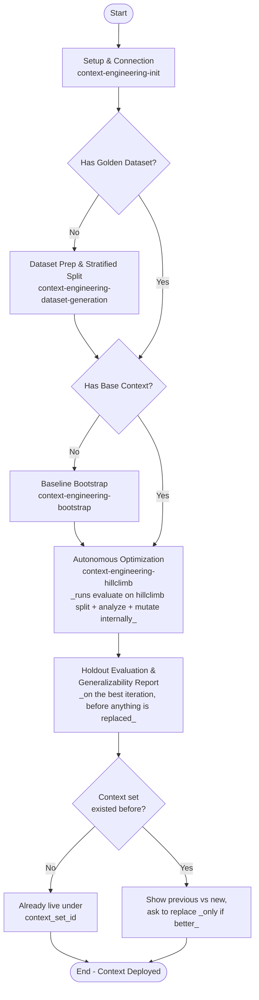

# Skill: Context Engineering Lifecycle

This skill defines the shared vocabulary, lifecycle, and safety rules used by the `context-engineering-*` peer skills. Consult it to orient before invoking a peer, or when a rule reads as "cross-cutting."

---

## Shared Terminology

A **ContextSet** is the structured knowledge blob the Gemini Data Analytics API consumes when translating a natural-language question to SQL. It contains three item types:

*   **Template** — a full NLQ → SQL mapping, generalized with placeholders (e.g., `$1`, `$2`). Teaches end-to-end query patterns.
*   **Facet** — a reusable SQL fragment (e.g., a `WHERE` predicate or a specialized join), tied to specific vocabulary. Composed into generated queries dynamically.
*   **Value Search** — a query that maps user-supplied terms (with typos, casing differences, or synonyms) to their exact database values. Resolves the value-linking problem.

See [context-engineering-generation-guide](../context-engineering-generation-guide/SKILL.md) for the JSON schemas and dialect-specific authoring standards.

---

## The Optimization Lifecycle & Phase Flow

To build high-performing data applications, context engineers typically follow a systematic, iterative optimization lifecycle (Hill-Climbing). 



---

## Kick-off: what to tell the user first

When a user starts (or asks how to start), give a **short, plain-language briefing** with the **numbered 5-step plan** before asking anything — do **not** recite split ratios, draft/publish mechanics or holdout statistics up front; each step explains itself when it begins, and detail is available on request. Template:

> * **Goal** — build a Context Set (what the Gemini Data Analytics API uses to turn your users' questions into SQL) and improve it until it answers reliably across 5 numbered steps:
>   1. **Step 1 of 5 — Setup & Database Connection**: connect to your database and save workspace/experiment settings.
>   2. **Step 2 of 5 — Evaluation Dataset & Split**: generate (or validate) the dataset which will be used for evaluations.
>   3. **Step 3 of 5 — Baseline Context Set (`v0`)**: generate initial Templates, Facets, and Value Searches from your schema and score `v0`.
>   4. **Step 4 of 5 — Iterative Hill-Climbing (`v1..vN`)**: analyze failed questions, refine the Context Set, and re-score in rounds until accuracy converges.
>   5. **Step 5 of 5 — Holdout Generalizability Check**: test the best Context Set once on the unseen holdout questions and publish the result.
> * **Experiment & state files** — everything for one attempt lives in `.context-engineering/experiments/<name>/`; `.context-engineering/workspace_state.md` holds what you tell me once (database, project + location, design docs to read, upload approval) and each experiment's `experiment_state.md` holds that run's record (Context Set name, every round's score, the final result). I never ask twice.
> * **I'll need** — the database connection (if not set up yet), project + location, a name for the Context Set (default: the experiment name), and — because improving the context set takes several rounds, each producing a draft version that is uploaded to be scored — whether to upload those draft iterations automatically or pause for your approval before each upload to review the ContextSet manually first. If `workspace_state.md` already exists I'll show you what it says and ask only whether to keep it.

**Announce every step transition (`Step X of 5`).** Whenever you start one of the 5 steps above (or transition from one step to the next), print a short header in chat before running tools so the user always knows where they are in the overall flow and what comes next:
```markdown
### 📍 Step <X> of 5: <Step Title>
* **Now**: <1 sentence on what this step is about to do>
* **Next**: <Step <X+1> of 5 — <Next Step Title> (or "Final report & publication" on Step 5)>
```

Then inspect the workspace and what the user provided, and **route automatically to the first required step** (do **not** ask a novice user to pick a phase from a menu when starting from scratch — guide them through the sequence `init` $\rightarrow$ `dataset-generation` $\rightarrow$ `hillclimb`, where `hillclimb` calls `bootstrap` internally to seed `v0`):

*   **Starting from scratch** (or whenever the experiment workspace, shared `.context-engineering/tools.yaml`, `.context-engineering/workspace_state.md`, or `.context-engineering/experiments/<experiment_name>/hillclimb/experiment_state.md` is missing) → start at [context-engineering-init](../context-engineering-init/SKILL.md), then proceed to `context-engineering-dataset-generation` and `context-engineering-hillclimb`
*   **Finished experiment** (`experiment_state.md` has `## Final:`) and the user wants to improve further → [context-engineering-init](../context-engineering-init/SKILL.md) in **clone mode** (see [references/holdout-evaluation.md](references/holdout-evaluation.md)); never hill-climb a finished experiment again
*   **No golden dataset** (`dataset/golden.json` or `dataset/splits/` missing in the experiment) → [context-engineering-dataset-generation](../context-engineering-dataset-generation/SKILL.md), followed by [context-engineering-hillclimb](../context-engineering-hillclimb/SKILL.md)
*   **Setup and dataset splits ready, ready to build/optimize context** (with no base ContextSet, a local ContextSet file, or an existing server resource) → [context-engineering-hillclimb](../context-engineering-hillclimb/SKILL.md) (which invokes [context-engineering-bootstrap](../context-engineering-bootstrap/SKILL.md) automatically when no base ContextSet exists)
*   **Improving a context set already published on the Context Set server** (`projects/…/locations/…/<collection>/<id>`) → [context-engineering-init](../context-engineering-init/SKILL.md) in **existing-context-set mode** (parses the name, asks same name vs new name), then dataset prep (if needed) and `context-engineering-hillclimb` (seeds `v0` from the server resource)
*   **User asks *only* for a standalone one-off baseline ContextSet file** (explicitly without evaluation or iterative optimization) → [context-engineering-bootstrap](../context-engineering-bootstrap/SKILL.md)
*   **User has a ContextSet and asks *only* for a single evaluation score** → [context-engineering-evaluate](../context-engineering-evaluate/SKILL.md)

Experienced users who state their coordinates and preferences up front skip the briefing; take what they gave, confirm only what is missing, and invoke the peer directly. "Preferences" means explicit statements of the preference itself (e.g. *"auto-approve uploads"*); an instruction to perform one action (*"upload it once"*) is not a preference — init still asks its approval question.

---

## Context Set (OneMCP) Protocol

All peer skills that touch the Context Set server (`bootstrap`, `evaluate`, `hillclimb`, and the `init` preflight) follow these rules. They are stated once here; peers reference them and repeat only the poll gate inline at each call site.

### Connection

The Context Set tools are served **directly by the remote OneMCP Context Set server** (a Dataplex MCP endpoint), not by this plugin's local MCP server. The plugin manifests register that remote server under the key `ctxset` with Google-credentials auth; the agent client (Antigravity / Jetski / Gemini CLI) attaches an Application Default Credentials bearer token automatically. If the five tools below are not visible in your tool list, the remote server is not connected: route to [context-engineering-init](../context-engineering-init/SKILL.md), which checks the connection and explains the fix (`gcloud auth application-default login` with a quota project, then reload MCP servers). Never substitute local HTTP calls (`curl`, `requests`) for these tools.

### Tools

Every tool identifies a context set by three separate arguments — `projectId`, `location`, `contextSetId` — never by a single resource-name string. Parameter names are exactly as the server advertises them in its tool schema; the schema the host shows you is authoritative if it ever differs from this table.

| Tool | Purpose | Returns |
| :--- | :--- | :--- |
| `list_context_set_locations(projectId)` | Discover which locations accept context sets. | `{"locations": [...]}`. |
| `upload_context_set(projectId, location, contextSetId, contextPayload, description?, databases?)` | Create **or overwrite** a context set from an inline JSON string. There is **no file-path argument**; see *Writing a context set from disk*. `databases` associates the context set with the database(s) it describes — see *Database association*. | A long-running operation (`name`). |
| `get_context_set(projectId, location, contextSetId)` | Read a context set. | `{"payload": "<ContextSet JSON string>", "description", "displayName", "databases": [...]}`. |
| `delete_context_set(projectId, location, contextSetId)` | Delete a context set. | A long-running operation (`name`). |
| `get_operation(projectId, location, operationId)` | Poll a long-running operation. | `{"done": bool, ...}` plus `error` on failure. |

### Database association (`databases`)

Every `upload_context_set` in this workflow **must** carry `databases` — the database the context set is for — so QueryData and the console can tie the context set to its source. `databases` is a list of structured objects:

```json
{"databaseType": "<SPANNER|CLOUD_SQL|ALLOYDB|FIRESTORE|BIGTABLE>", "projectId": "…", "location": "…", "clusterId": "…", "instanceId": "…", "databaseId": "…"}
```

Keys are camelCase (`databaseType`, `projectId`, `clusterId`, `instanceId`, `databaseId`), as in the server's tool schema; `get_context_set` returns `databases` in the same shape, so a returned list can be passed back to `upload_context_set` unchanged.

**Derive it at upload time — never record it.** Take the **Source Name** under `## Active Database` in `experiment_state.md` (standalone: the chosen source), read that `kind: source` block from `.context-engineering/tools.yaml`, and map it with the table below (omit fields that do not apply). `tools.yaml` stays the single place connection details live; `experiment_state.md` only names the source.

| `tools.yaml` source `type` | `databaseType` | `projectId` | `location` | `clusterId` | `instanceId` | `databaseId` |
| :-- | :-- | :-- | :-- | :-- | :-- | :-- |
| `alloydb-postgres` | `ALLOYDB` | `project` | `region` | `cluster` | `instance` | `database` |
| `cloud-sql-postgres`, `cloud-sql-mysql` | `CLOUD_SQL` | `project` | `region` | — | `instance` | `database` |
| `spanner` (GoogleSQL or PostgreSQL dialect) | `SPANNER` | `project` | — | — | `instance` | `database` |
| `bigtable` | `BIGTABLE` | `project` | — | — | `instance` | — |
| `firestore` | `FIRESTORE` | `project` | — | — | — | `database` (e.g. `(default)`) |
| `bigquery`, `custom` | *(no `databaseType` exists for these)* — **omit the `databases` argument** for this source; tell the user once that the context set will not be linked to a database. | | | | | |

Rules:
*   **Always pass it** — iteration uploads, the final candidate upload, bootstrap's optional upload, and evaluate's standalone upload all include `databases` derived as above from the experiment's **Source Name** + `tools.yaml` (standalone bootstrap/evaluate: from the chosen source). Omitting it on a *new* context set leaves the association empty; the server only preserves an existing list when the field is omitted on an *update*.
*   **A context set that already existed keeps its association.** The server semantics are: `databases` **omitted** on an update → the existing list is preserved; `databases` **provided** → the whole list is **replaced**. There is no append call — appending means *read the current list, add to it, send the full list*. So, for an existing set:
    *   During the run nothing is written to it at all (iterations go to `<id>_draft`, which is a resource this run creates and therefore **does** get the derived `databases` like any fresh upload).
    *   At the final replacement (existing-case Finalize, after the user's yes), **never send only the experiment's database**. Send the `**Seed databases**` list that `get_context_set` returned when `v0` was downloaded **plus** the derived database (appended, de-duplicated) so nothing already associated is dropped.
    *   The existing set's association is never otherwise edited — no re-asserting, no pruning, no reordering.
*   Never invent values: every field comes from `tools.yaml`; if a required field for the type is missing there, stop and route to `context-engineering-init`.

### Resource naming

A context set resource name has the shape

```
projects/<project_id>/locations/<location>/<collection>/<context_set_id>
```

where `<collection>` is the service's collection segment — **`contextSets` today, expected to become `entryGroups`**. The skills never depend on that segment:

*   **Parsing (always by position, never by validating the collection):** `projectId` = the segment after `projects`, `location` = the segment after `locations`, `contextSetId` = the **last** segment. Accept any collection segment; if the name does not have the `projects/…/locations/…/<collection>/<id>` structure at all, ask the user to re-check it rather than guessing.
*   **Calling tools:** every tool takes the three parsed parts (`projectId`, `location`, `contextSetId`) — never the full string — so the collection segment is irrelevant to tool calls.
*   **Recording names in `experiment_state.md`:** when the user supplied a resource name, record it **verbatim** as the resource it refers to (`Seed Context Set resource`, and `Final Context Set resource` when improving in place). Derive the `Draft Context Set resource` from it by replacing only the last segment with `<context_set_id>_draft`, keeping the user's collection segment. Only when *no* name was supplied (fresh experiment) construct `Final Context Set resource` / `Draft Context Set resource` with the current default collection `contextSets`. If a tool response carries a resource `name`, prefer that string verbatim over a constructed one.
*   **Passing names to Evalbench:** `generate_evalbench_configs(context_set_id=…)` passes the string straight through to Evalbench/QueryData; give it the recorded resource string unchanged.

> [!IMPORTANT]
> **This section is the only definition of the resource-name shape.** Peer skills (`init`, `bootstrap`, `evaluate`, `hillclimb`) and the examples in `context-engineering-hillclimb/references/layout.md` refer to it as *the Resource naming rule* and must not spell out a different path. When the service switches collection, change the default collection word above and the `layout.md` examples; nothing else should need to change.

*   `<context_set_id>` is user-chosen. `context-engineering-init` asks for it once (default: the experiment name) and records it in `experiment_state.md`; peers read it from there.
*   **Working copy — decided by whether `<context_set_id>` already exists when init probes it**, and recorded as the `Draft Context Set resource` bullet:
    *   **Fresh** (did not exist): there is **no `_draft`**. Hill-climbing uploads every iteration straight to `<context_set_id>`, re-uploads the best iteration to the same name at the end, and runs the holdout test on it. Nothing is deleted. `Draft Context Set resource: (none — new context set; iterations upload to the final name)`.
    *   **Existing** (already there): hill-climbing uploads every iteration to `<context_set_id>_draft` and **never writes to `<context_set_id>` during the run**. At the end the best iteration is placed in the draft, the holdout test runs on the draft, and the user is asked — always, regardless of `Auto-approve uploads`, and only if the candidate beats `v0` — whether to replace the existing set. The draft is deleted afterwards either way. `Draft Context Set resource: …/<context_set_id>_draft`.

### Improving a context set that already exists on the Context Set server

When the user hands over an existing resource name ("improve / fix `projects/…/<collection>/<id>`"), `context-engineering-init` parses it (rule above), confirms it exists, records it **verbatim** as `Seed Context Set resource` (its project and location are then carried by that string — `workspace_state.md` is not edited, and a mismatch with the workspace defaults is only mentioned in the summary), and asks **one** question — should the improved version replace it (**same name**, the default) or be published under a **new name**?

*   **Same name** → `Context set id` = parsed `<id>`, `Final Context Set resource` = the supplied string. Because the name exists, the *existing* working-copy rule applies automatically: iterations run on `<id>_draft`, the original is untouched until the end-of-run HITL, and the original payload is kept locally as `v0/context_set_v0.json`.
*   **New name** → `Context set id` = the new name; it does not exist, so the *fresh* rule applies and the seed is never written to.

In both cases hillclimb seeds `v0` from the existing resource via `get_context_set` (not bootstrap). No extra bookkeeping (`Publish mode` or similar) is needed — the `Seed Context Set resource`, `Final Context Set resource` and `Draft Context Set resource` bullets fully determine the behaviour.

### Location resolution

Location is resolved **once per workspace**, by `context-engineering-init` when it writes `workspace_state.md`: it calls `list_context_set_locations(projectId)`, lets the user pick (or confirms a named location is in the list), and records the choice there. When the user supplied an existing resource name, the location parsed from it is used for that experiment and only confirmed against the list — not re-asked. Peers never call `list_context_set_locations` again: for tool calls they parse the location from the experiment's resource names (below). Do not assume a default location.

### Inputs & resolution rules (`workspace_state.md` vs `experiment_state.md`)

Two files, two jobs. `.context-engineering/workspace_state.md` holds **what the user entered once for the workspace** — `Project`, `Location`, `Default DB source`, `Enrichment sources`, `Auto-approve uploads` (format and example in `context-engineering-hillclimb/references/layout.md`). Each `experiments/<name>/hillclimb/experiment_state.md` holds **the record of one run** — `Context set id`, `Final Context Set resource`, `Draft Context Set resource`, `Seed Context Set resource`, datasets, `## Active Database`, iterations, verdict. Resolution:

1.  **Context-set identity never comes from `workspace_state.md` after init.** Every tool call parses `projectId` / `location` / `contextSetId` from `Final Context Set resource` / `Draft Context Set resource` / `Seed Context Set resource` in `experiment_state.md` (Resource naming rule). Init consumes `workspace_state.md`'s `Project`/`Location` exactly once, to construct `Final Context Set resource`. Consequence: editing `workspace_state.md` later cannot retarget a running experiment, and improving a resource that lives in another project needs no override.
2.  **`Auto-approve uploads`** — effective value = `Auto-approve uploads (this experiment)` in `experiment_state.md` if present → else `workspace_state.md` → else `false`. Hillclimb re-reads it on every entry.
3.  **`Enrichment sources`** — `Enrichment sources (this experiment)` in `experiment_state.md` if present → else `workspace_state.md`. Read by dataset-generation (realistic questions, terminology) and by bootstrap when hillclimb seeds `v0` (business terms, join rules). User-facing wording never says "bootstrap" — say "the evaluation questions and the initial context set".
4.  **`Default DB source`** — `## Active Database` in `experiment_state.md` is authoritative once written; `workspace_state.md` only pre-fills init.
5.  **Only `context-engineering-init` writes `workspace_state.md`** (creation, "change my defaults", a new Default DB source). Every other skill is read-only on it; a user asking mid-run to change a default is routed to init.
6.  **New experiment while the file exists**: init shows the recorded inputs verbatim and asks once — keep / change for this experiment only (→ `(this experiment)` bullets in `experiment_state.md`) / change the defaults (→ file updated with a `## History` line). It never silently reuses them without showing them.

> [!IMPORTANT]
> This section is the only definition of the precedence between the two files. Peer skills refer to it as *Inputs & resolution rules* and must not restate a different order.

### Writing a context set from disk

`upload_context_set` accepts the ContextSet only as an inline JSON string in `contextPayload`. To upload a file:

1.  Run `validate_context_set` (local plugin tool) on the file. Do not upload a file that fails validation.
2.  Read the file with ordinary file tooling.
3.  Call `upload_context_set` with `contextPayload` set to the **exact, complete** file contents. Do not summarise, reformat, truncate, or "fix" the JSON on the way through; the payload must round-trip byte-for-byte in meaning.
4.  Follow the poll gate below.

### Long-running operations — the poll gate

`upload_context_set` and `delete_context_set` are **asynchronous**: the tool returns as soon as the request is accepted, not when the work is done. After either call:

1.  Take `name` from the response. It has the form `projects/<project_id>/locations/<location>/operations/<operation_id>`; the last path segment is the `operationId`.
2.  Call `get_operation(projectId=…, location=…, operationId=…)` with those three parts.
3.  If `done` is not `true`, wait **at least 5 seconds** and call again (the server asks for ≥5 s between polls). Stop after 5 minutes total.
4.  Log every poll response so the user can see progress.
5.  **`done: true` means the operation is complete.** Continue with the next step. No additional verification call is needed.
6.  `done: true` together with an `error` field means the operation failed. Surface the error verbatim and stop.
7.  If the 5-minute ceiling is reached, surface the operation name and stop.

**Never act on a context set whose upload operation has not yet reported `done: true`.** In particular, `evaluate` must not generate Evalbench configs or launch an evaluation until the upload it depends on is done; otherwise the evaluation runs against a missing or stale context set and its score is meaningless.

### Reading a context set to disk

`get_context_set` returns the ContextSet as a JSON string in `payload`. Parse it and write it to the target path with ordinary file tooling; the tool does not write files.

### Overwrite hazard

`upload_context_set` is an upsert: uploading to a `<context_set_id>` that already exists **silently replaces its contents**, and the previous contents cannot be recovered from the server. The skills handle this structurally rather than with a one-time acknowledgement:

1.  `context-engineering-init` probes the bare `<context_set_id>`. If it exists, it **warns the user up front** (iterations will go to `_draft`; the existing set is untouched until the end; one `delete_context_set` on the draft will follow) and offers a different name.
2.  During the run, an existing `<context_set_id>` is **never written**.
3.  At the end, the holdout test runs on the candidate **before** anything is replaced, and the replacement is a **mandatory HITL** — previous vs new results side by side — asked only if the candidate beats `v0`, and regardless of `Auto-approve uploads`. The previous contents are preserved locally as `v0/context_set_v0.json` and can be re-uploaded on request.

A fresh `<context_set_id>` (NOT_FOUND at init) needs none of this: it is created by the first iteration upload and never contained anything else.

### Idempotent delete

A `delete_context_set` that fails with NOT_FOUND is treated as success. This matters when resuming an interrupted hill-climb run, where a draft may already have been removed.

---

## Workflow Phases, Rationales & Entry Prerequisites

---

### Setup & Connection Configuration
*   **Reference**: [context-engineering-init](../context-engineering-init/SKILL.md)
*   **Goal**: Configure `.context-engineering/tools.yaml` for the Toolbox MCP server, verify runtime + GCP readiness, record workspace defaults once in `.context-engineering/workspace_state.md`, and initialize `.context-engineering/experiments/<experiment_name>/hillclimb/experiment_state.md` (supporting fresh, existing-context-set, and clone modes). Remind the user to restart the `toolbox` MCP server after any change to `tools.yaml`.

---

### Master Loop Control & Tuning Target Gate (`Loop{Tuning Target Met?}`)
As the master orchestrator, this skill strictly governs phase transitions after every evaluation run (`Run Evaluation And Score`) inside the optimization loop:

*   **Stopping Conditions** (defined in `context-engineering-hillclimb` and checked in this order after every evaluation):
    *   **Tuning target** — `TUNING_TARGET = 1.0`: **100% accuracy (`0` failed queries)** on `splits/hillclimb.json`.
    *   **Plateau** — `PLATEAU_K = 3`: the last 3 iterations all failed to beat the best score so far.
    *   **Iteration cap** — `MAX_ITERATIONS = 10` iterations have been evaluated.
    *   An explicit in-prompt override by a power user applies to the current session only.
*   **Mandatory Post-Evaluation Check (Immediate Autonomous Branching)**:
    *   Immediately upon completing any `Run Evaluation And Score` pass on `splits/hillclimb.json`, inspect the evaluation pass rate (`passed / total`) and failed query count:
        1.  **When any Stopping Condition fires** (`pass_rate >= tuning_target`, plateau, or iteration cap):
            *   **HALT Hill-Climbing Immediately**: Do **not** enter `Optimization & Hill-Climbing Phase` and do **not** suggest another refinement loop.
            *   **Finalize (hillclimb skill)**: put the best-scoring iteration `vK` in the **working copy** (re-upload if the last iteration was not the best; poll gate) and record `## Finalizing: vK`.
            *   **Zero-Confirmation / No-Yield Rule (Strictly Enforced)**: Do **NOT** conclude or yield your turn after scoring `splits/hillclimb.json`, and do **NOT** ask the user for permission, confirmation, or approval to proceed to the generalizability test.
            *   **Immediately Execute Generalizability Test in the Same Turn** against the **working copy** per [references/holdout-evaluation.md](references/holdout-evaluation.md) (`generate_evalbench_configs` on `splits/holdout.json` $\rightarrow$ `uvx google-evalbench@1.18.0` $\rightarrow$ `evaluate_generalizability` $\rightarrow$ write `final_evaluation_report.md` + `## Generalizability`).
            *   **Then set the publication state** (hillclimb Finalize step 4): fresh context set → it is already live under `<context_set_id>`, write `## Final:`; existing context set → the **one** HITL of the run (previous vs new, only if `vK` beats `v0`; replace or keep), delete `_draft`, write `## Final:`. Then display the On-Screen Card and, for non-PASS verdicts, the hand-off card per [references/holdout-evaluation.md](references/holdout-evaluation.md).
        2.  **When no Stopping Condition fires (`pass_rate < tuning_target` and `failed > 0`)**:
            *   Proceed to `Optimization & Hill-Climbing Phase` (`context-engineering-hillclimb`) to perform Gap Analysis and Context Mutation on the failed queries, then re-evaluate.
        3.  **When the user explicitly asks to stop**: finish the current iteration cleanly, append `## User Stop` to `experiment_state.md`, and **do not finalize and do not run the holdout test**. A later resume offers the choice to continue or finalize.

---

### Evaluation Dataset Prep & Stratified Partitioning
*   **Reference**: [context-engineering-dataset-generation](../context-engineering-dataset-generation/SKILL.md)
*   **Requires**: Setup & Connection Configuration complete.
*   **Goal**: Build a high-quality "golden" ground-truth dataset at `.context-engineering/experiments/<experiment_name>/dataset/golden.json` and partition it into `dataset/splits/hillclimb.json` (Hillclimbing Questions) and `dataset/splits/holdout.json` (Holdout Variations) using the `split_dataset` MCP tool, strictly enforcing that every normalized SQL template (key) in `splits/holdout.json` is included in `splits/hillclimb.json`. The whole `dataset/` directory — golden set, splits, and the skill's working files (plan, environment report, interim dataset, audit reports) — lives **inside the experiment**; nothing is written to the current working directory. **The only dataset input that ever comes from outside the skill is `golden.json`** — a user's own evaluation set or a copy from a finished experiment (init's clone flow copies *only* `golden.json`); the split is always produced here, in this experiment, by `split_dataset`. Because `split_dataset` is deterministic, an unchanged `golden.json` yields identical splits, which is what keeps cloned experiments comparable. Each experiment's `experiment_state.md` records the dataset paths under `## Metadata`; the `Golden dataset` bullet carries how a pre-existing file is to be handled — `(split as is)` or `(expand before split)`, written by init — and becomes `(generated)` once this phase has produced the splits.
*   **Mandatory Stratified Split Enforcement (`split_dataset`)**:
    *   **Always Use `split_dataset` MCP Tool**: You MUST invoke the `split_dataset` MCP tool to generate `splits/hillclimb.json` and `splits/holdout.json` (for both newly generated datasets and user-supplied datasets). You are **strictly forbidden** from manually slicing or partitioning dataset JSON files via custom Python scripts or shell commands, and from accepting user-made splits.
    *   **Holdout-in-Hillclimb SQL Template Invariant**: Every normalized SQL template (key) in `splits/holdout.json` **MUST** be included in `splits/hillclimb.json` (`holdout_keys <= hillclimb_keys`). Single-variation SQL templates (appearing only once in the golden dataset) are placed exclusively in `splits/hillclimb.json` and never in `splits/holdout.json`.
    *   **Template-Preserving Expansion**: When expanding seed or user-supplied queries to reach the target dataset size (e.g., 150 items: 105 hillclimbing / 45 holdout), ensure sufficient variations preserve the normalized `golden_sql` template (using Paraphrasing, Distraction Injection, Linguistic Variation, or Value Substitution). If `split_dataset` fails because too many templates have only a single variation, expand existing SQL templates with template-preserving phrasing/parameter variations and re-run `split_dataset`—never bypass `split_dataset`.
*   **Dataset Proposal & Input Scenarios**:
    *   **Proposal in Chat**: Crema proposes creating a dataset with 150 questions across 30 query patterns (105 hillclimbing questions for optimization, 45 holdout variations to test generalizability, default split ratio 0.7 and minimum holdout size 45). Internal partitions are preserved in `splits/hillclimb.json` and `splits/holdout.json` without exposing a separate `split_report.md` to the user.
    *   **Scenario (a) Full Automated Flow**: User accepts proposal $\rightarrow$ generate, expand NLQ variations, run `split_dataset` to produce stratified hillclimb/holdout splits, hill-climb on hillclimb split, holdout evaluation, generalizability reporting, publication decision.
    *   **Scenario (b) User-Supplied Dataset (Auto-Split)**: User provides their own evaluation set $\rightarrow$ tell them it must be the single golden set at **`.context-engineering/experiments/<experiment_name>/dataset/golden.json`** (offer to copy it there) $\rightarrow$ Crema auto-expands question phrasings if needed (preserving normalized SQL templates) and runs `split_dataset` into 105 hillclimbing / 45 holdout ($N_{\text{test}} \ge 45$, default split ratio 0.7, every holdout SQL template included in hillclimb); never ask the user to pre-partition.
    *   **Scenario (c) Pre-Partitioned Datasets (Fail Early)**: User attempts to supply separate dev/test files or a hand-made `splits/` $\rightarrow$ fail early with `[ERROR] InvalidDatasetConfiguration` and explain that only `golden.json` can be supplied; the split is generated by the skill.
    *   The split is **not optional**: there is no "skip holdout" path. Every golden dataset is split into `splits/hillclimb.json` and `splits/holdout.json`, and every completed hill-climb run ends with a holdout evaluation.

---

### Baseline Context Bootstrapping
*   **Reference**: [context-engineering-bootstrap](../context-engineering-bootstrap/SKILL.md)
*   **Goal**: Generate a baseline `ContextSet` (Templates, Facets, Value Searches) from database schema and optional enrichment sources (invoked automatically by `context-engineering-hillclimb` when seeding `v0`, or standalone on explicit request).
*   **Requires**: Setup & Connection Configuration complete.

---

### Evaluation Scoring
*   **Reference**: [context-engineering-evaluate](../context-engineering-evaluate/SKILL.md)
*   **Goal**: Run Evalbench against a ContextSet + golden dataset to produce an accuracy score and per-query failure breakdown.
*   **Requires**: Setup & Connection Configuration complete; a golden dataset and a ContextSet (local file or Context Set resource name) available.

---

### Autonomous Optimization
*   **Reference**: [context-engineering-hillclimb](../context-engineering-hillclimb/SKILL.md)
*   **Goal**: Autonomously iterate evaluate → analyze → mutate → re-upload until improvements dry up, producing a high-scoring ContextSet with no per-iteration user approval.
*   **Requires**: Setup & Connection Configuration complete; a golden dataset. The base context is optional and can be **(a)** none — hillclimb invokes bootstrap, **(b)** a local ContextSet file, or **(c)** a context set **already published on the Context Set server**, given by resource name (any collection segment; see *Improving a context set that already exists on the Context Set server* — init records it as `Seed Context Set resource` and the user chooses in-place or new-name publishing; hillclimb downloads it as `v0`).
*   **Note**: Hillclimb runs evaluate itself every iteration; do not run Evaluation Scoring separately as a precondition.

---

### Holdout Evaluation & Generalization Reporting Phase
*   **Reference**: [references/holdout-evaluation.md](references/holdout-evaluation.md) — **load this reference file** when entering Finalize step 3 (`## Finalizing: vK`), rendering the final On-Screen Card and Next-Experiment Hand-off card, or triaging a `final_evaluation_report.md` verdict (`PASS`, `INCONCLUSIVE`, or `INVESTIGATE` Path A / Path B).
*   **Summary**: Evaluates the candidate working copy (`<context_set_id>` in the fresh case, `<context_set_id>_draft` in the existing case) on `splits/holdout.json` strictly once in a single read-only pass (zero data leakage), runs the two-proportion pooled z-test via `evaluate_generalizability`, writes `final_evaluation_report.md` and `## Generalizability` in `experiment_state.md`, and returns the verdict to `context-engineering-hillclimb` Finalize step 4 before printing the On-Screen Card and (for `INVESTIGATE` / `INCONCLUSIVE`) the Next-Experiment Hand-off card.

---

## Safety & Protocol

*   **Unconfigured Database & MCP Tool Probing**:
    *   Before calling any database MCP tools (such as `<source>-list-schemas`, `<source>-list-graphs`, `<source>-execute-sql`), verify that `.context-engineering/tools.yaml` exists and is configured, and — inside an experiment — that the **Source Name** recorded under `## Active Database` in `experiment_state.md` is one of its sources and that its `<source>-*` tools are visible in your tool list. If the source is in the file but its tools are not visible, the `toolbox` MCP server is stale (it reads `tools.yaml` only at startup): **tell the user to restart it** (Gemini CLI `/mcp reload`; Claude Code `/mcp` → `toolbox` → Reconnect; Antigravity `/mcp` → `toolbox` → Restart) before continuing.
    *   **Strictly Forbidden**: If `.context-engineering/tools.yaml` is missing or unverified, you are **strictly forbidden from proceeding**.
    *   **Mandatory Action**: You **MUST immediately halt and yield the turn** to solicit the database connection parameters (Project ID, Instance ID, Database ID, Dialect [for Spanner: GoogleSQL vs. PostgreSQL], and any target tables/property graphs) and an experiment name from the user. Do not proceed on the workflow until the user provides this information.

*   **Missing Dataset**:
    *   If the user's request requires **evaluating, scoring, or optimizing** a context set (e.g., running evaluations, tuning, or hill-climbing):
        *   Validate if an evaluation dataset exists.
        *   **Mandatory Halt & Guide**: If no evaluation dataset exists, you are **strictly forbidden** from executing any context bootstrapping, tuning, or evaluation operations in this turn. You must immediately halt, stop calling tools, and yield the turn. Explain **why a golden evaluation dataset is critical** for context engineering (i.e., you cannot objectively score, validate, or hill-climb translation accuracy without a ground-truth dataset), and ask if they would like help generating one first.

*   **Critical API Error Protocol**:
    *   Seek guidance from the user if you run into results where retrying is unlikely to solve the issue.
    *   Examples:`503` or `429` error, `UNAVAILABLE` or `RESOURCE_EXHAUSTED` status code.
    *   Why: These errors are often associated with quota issues, and retrying the request immediately will not resolve the issue. For issues related to Vertex AI Resource Exhaustion, retrying at a later time is often the only solution.

*   **Environment failures**: For any environment or connection failure (missing `tools.yaml`, MCP tools unreachable, ADC not configured, API not enabled, IAM missing), route through [context-engineering-init](../context-engineering-init/SKILL.md) to diagnose and fix. Do not invent workarounds (e.g., calling Toolbox via bash instead of MCP).